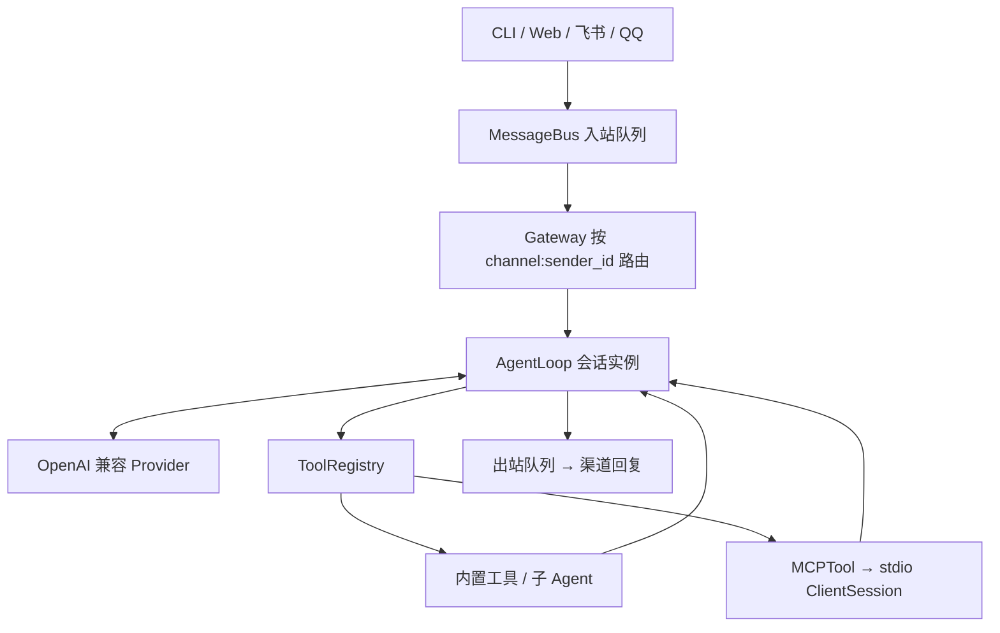

# CLAW 智能 Agent 框架

基于 Python 实现的轻量 Agent 项目。用户可通过命令行、网页、飞书或 QQ 向助手下达任务，由模型选择工具完成文件读写、命令执行、联网检索和多步骤任务；也可接入 MCP 服务扩展能力。

运行时代码中的 `NanoClaw` 与本项目 CLAW 指同一项目。未依赖 LangChain 等 Agent 编排框架。

## 功能

- **多轮工具调用**：模型返回工具请求后执行并回填结果，继续推理直到生成回答或达到执行限制。
- **统一工具注册**：8 个内置工具（文件读写、目录查看、Shell、搜索、网页抓取、系统信息、技能加载），另有临时子 Agent 工具。
- **MCP 扩展**：通过 stdio 连接服务，发现工具并转换为 Function Calling 定义；附带备忘录、古诗词两个示例服务。
- **统一渠道**：CLI、FastAPI/WebSocket 网页、飞书长连接和 QQ Bot 共用消息总线及 Agent 内核。
- **上下文管理**：按渠道与用户维护独立的内存历史；提供基于字符估算的历史摘要压缩，以及按需读取 SKILL.md 的技能工具。

## 架构与工具调用



1. `Tool.to_function_definition()` 将名称、描述、JSON Schema 交给模型；Provider 使用 `AsyncOpenAI` 请求兼容 Chat Completions 的端点。
2. Provider 解析 `tool_calls` 中的 JSON 参数，`AgentLoop` 保存 assistant 工具请求；注册表按名称执行工具。
3. 结果以 `role=tool`、原始 `tool_call_id` 回填下一轮请求。同一响应中的多个调用**依次执行**。
4. MCP 启动时执行 `initialize()`、`list_tools()`，复用服务端 `inputSchema`，以 `服务名__工具名` 注册；调用时映射回 `session.call_tool()`。
5. 工具异常转换为文本结果；默认最多 32 轮，相同工具与参数在 30 条窗口中第 10 次起跳过并警告、第 20 次熔断。Shell 有 60 秒超时与输出截断。

Asyncio 负责渠道生命周期、消息队列、异步模型及工具 I/O；阻塞输入和搜索通过 `to_thread` 运行，飞书回调通过线程安全投递进入主循环。FastAPI 提供网页和 `/ws`，WebSocket 传输完整消息，当前没有逐 token 流式输出。

```text
main.py / config.py    配置与组装入口
bus/ / gateway.py     双向消息队列、路由与生命周期
agent/                执行循环、上下文、摘要压缩
agent/tools/          工具抽象、注册表、内置工具及 MCP 适配
providers/            LLM 抽象与 OpenAI 兼容实现
channels/             CLI、Web、飞书、QQ 与网页 UI
mcp_servers/          FastMCP 示例服务
session/manager.py    独立 JSONL 会话存储组件（尚未接入主流程）
output/skills/        两个示例技能；其余 output 内容为本地产物
scripts/              无密钥验证与公开文件检查
```

## 安装与运行

推荐 Python 3.12，在**项目根目录**运行。Windows PowerShell：

```powershell
py -3.12 -m venv .venv
.venv\Scripts\Activate.ps1
python -m pip install -r requirements.txt
Copy-Item config.example.json config.json
New-Item -ItemType Directory -Force output, logs | Out-Null
$env:NANOCLAW_API_KEY = "替换为自己的密钥"
python -X utf8 main.py
```

本次验证环境的完整依赖快照见 `requirements-lock.txt`（Windows / Python 3.12.7）；相同平台可用 `python -m pip install -r requirements-lock.txt` 复现。若默认镜像无法解析包，可追加 `--index-url https://pypi.org/simple`。

Linux/macOS 可用 `python3.12 -m venv .venv`、`source .venv/bin/activate`、`cp config.example.json config.json`、`mkdir -p output logs` 和 `export NANOCLAW_API_KEY='自己的密钥'`，其余命令相同。

Windows 使用 `-X utf8` 避免部分终端因工具日志中的 Emoji 发生编码异常。

在 `config.json` 中设置 `base_url`、支持工具调用的 `model` 和 `workspace`。环境变量 `NANOCLAW_API_KEY`、`FEISHU_APP_ID`、`FEISHU_APP_SECRET`、`QQ_APP_ID`、`QQ_APP_SECRET` 优先于文件；程序不会自动读取 `.env`。

- CLI：输入任务；`/tools` 查看工具，`/clear` 清空当前 CLI 内存历史，`/exit` 关闭整个网关。
- Web：启动同一进程后访问 [本地页面](http://127.0.0.1:8080)，通过 `/ws` 收发文本；每次新连接分配新会话。
- 飞书 / QQ：配置机器人凭据与平台对应的文本消息事件及权限后，随主进程启动；空凭据会跳过连接。SDK 在入口处直接导入，因此安装依赖时仍需包含它们。
- MCP：示例配置启动两个 Python 服务，共发现 6 个工具。`command` 应能在当前 PATH 中找到；无需 MCP 时将 `mcp_servers` 改为 `{}`。

可尝试：“在工作目录写一份 todo.txt”“搜索 Python asyncio 资料并整理要点”“读取 CSV 并生成分析脚本”。模型执行效果依赖所选端点及网络。

## 验证

```powershell
python -X utf8 scripts/verify.py
python -X utf8 scripts/audit_public.py
```

前者使用模拟模型验证核心闭环及本地 WebSocket，不使用真实模型密钥；后者检查 Git 索引中的公开候选文件。另有 `python -X utf8 scripts/verify_mcp.py` 真实 stdio 诊断：当前可发现与调用工具，但双服务清理会报错并非零退出，用于复现已知问题。实际验证结果和能力边界见 [源码审查记录](docs/REVIEW.md)，简历文案见 [项目经历](docs/RESUME.md)。

## 当前边界

- Gateway 仅有一个入站消费循环，逐条等待 Agent 完成；渠道并发不等于任务并行。
- 独立内存历史不等于租户隔离：同一用户跨群聊复用历史，工作目录、备忘录及长期记忆文件共享；重启不恢复历史，JSONL 组件未接入主流程，Agent 缓存尚无淘汰机制；当前历史保存未包含最终 assistant 文本回答。
- 摘要压缩按消息条数裁剪，可能切断工具调用配对；压缩后的历史保存逻辑仍需完善，`max_tokens` 配置未传入模型请求。简历不宣称可靠的长期记忆或严格 Token 预算控制。
- 参数 JSON 解析失败降级为 `{}`，没有完整的 JSON Schema 本地校验。MCP 当前只有 stdio，连接超时保护不覆盖工具执行；双服务退出已复现取消作用域清理异常。主入口快速退出还可能留下 Uvicorn lifespan 待清理任务警告。
- Web 默认监听 `0.0.0.0:8080` 且没有鉴权；文件路径校验使用字符串前缀，Shell 黑名单也不是隔离沙箱。仅应在可信本地环境运行，勿直接暴露到公网。
- QQ 回复采用先单聊后群聊的回退策略，未完整保留原消息类型和消息 ID；飞书与 QQ 的真实收发需各自平台联调。

本地配置、日志、备忘录、生成文件、虚拟环境和历史分析图不纳入公开仓库。此次整理保留核心实现，仅调整文档、依赖与仓库规则。
